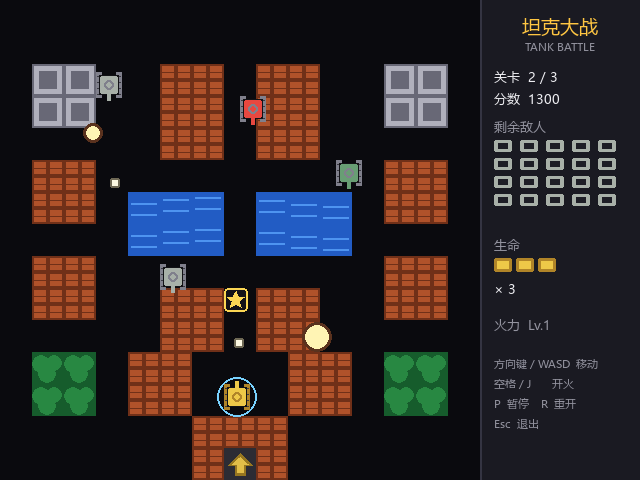

# 坦克大战 Tank Battle

经典《坦克大战》的 Python + Pygame 复刻：守住基地，消灭一波波敌方坦克，连续通过 3 张手工关卡。



[](https://github.com/sqgug123/tank-battle/actions/workflows/ci.yml)

## 特性

- **3 张手工关卡**：砖墙、钢墙、水域、树林四种地形，砖墙可被打碎
- **3 种敌人**：普通、快速、重装（3 点血），敌人会追击玩家与基地并寻找射击机会
- **4 种道具**：火力升级、手雷清屏、护盾、加命；每 4 辆敌人出现 1 辆闪烁奖励坦克
- **完整流程**：标题菜单、暂停、过关结算、失败重开、通关胜利
- **零外部素材**：所有画面由 pygame 图元绘制，中文界面自动匹配系统字体
- **逻辑与渲染分离**：核心玩法不依赖 pygame，54 个 pytest 用例 + 无头冒烟测试
- **无音效依赖**：不加载任何音频文件，clone 即可运行

## 安装与运行

需要 Python 3.9+。

```bash
git clone https://github.com/sqgug123/tank-battle.git
cd tank-battle
python -m pip install -r requirements.txt
python main.py
```

> Windows 用户如果 `python` 不可用，可改用 `py main.py`。

## 操作

| 按键 | 功能 |
| --- | --- |
| 方向键 / WASD | 移动坦克 |
| 空格 / J | 开火（按住可连射，受冷却限制） |
| P | 暂停 / 继续 |
| R | 重新开始 |
| Enter | 菜单或结算界面开始游戏 |
| Esc | 退出 |

## 玩法规则

- 玩家初始 3 条命，出生后 3 秒无敌（蓝色护盾闪烁）。
- 每关 20 辆敌方坦克，同屏最多 4 辆；击毁第 4、8、12、16、20 辆奖励坦克会掉落道具。
- **砖墙**可被子弹打碎；**钢墙**无法破坏；**水域**坦克不能通过但子弹可以；**树林**不阻挡移动，只遮挡视线。
- 基地（老鹰）被任意子弹击中即失败；玩家生命耗尽同样失败。
- 通过第 3 关即胜利。

### 道具

| 图标 | 名称 | 效果 |
| --- | --- | --- |
| ★ | 火力升级 | 最多同时发射 2 发子弹，Lv.2 子弹更快 |
| 手雷 | 手雷 | 立即摧毁场上全部敌方坦克 |
| 盾 | 护盾 | 10 秒无敌 |
| ＋ | 加命 | 生命 +1 |

道具在场上停留 12 秒，最后 3 秒闪烁提示。

## 项目结构

```
tank-battle/
├── main.py                 # 入口
├── tank_battle/
│   ├── config.py           # 尺寸、速度、颜色等常量
│   ├── geometry.py         # AABB 等纯数学工具
│   ├── tiles.py            # 地形网格与可通行性
│   ├── entities.py         # 坦克、子弹、道具、爆炸
│   ├── ai.py               # 敌人决策与视线判定
│   ├── levels.py           # 3 张 ASCII 关卡与解析
│   ├── game.py             # 状态机与全部游戏规则（不依赖 pygame）
│   ├── renderer.py         # 绘制与 HUD
│   └── app.py              # 窗口、输入、固定步长主循环
├── tests/                  # pytest 用例
├── tools/make_screenshot.py
├── docs/screenshot.png
└── .github/workflows/ci.yml
```

### 分层约定

`config.py`、`geometry.py`、`tiles.py`、`entities.py`、`ai.py`、`levels.py`、`game.py` 均不导入 pygame，可在无显示器环境运行和测试；`renderer.py` 只读取状态绘制；`app.py` 负责输入与循环。

## 测试

```bash
python -m pytest -q
```

无头环境可设置：

```bash
SDL_VIDEODRIVER=dummy SDL_AUDIODRIVER=dummy python -m pytest -q
```

覆盖地形阻挡、分轴移动与对齐、子弹命中优先级、基地判定、敌人 AI、刷怪上限与奖励坦克、四种道具、关卡流程与 3000 帧随机操作稳定性。

重新生成截图：

```bash
python tools/make_screenshot.py
```

## 许可证

[MIT](LICENSE)
